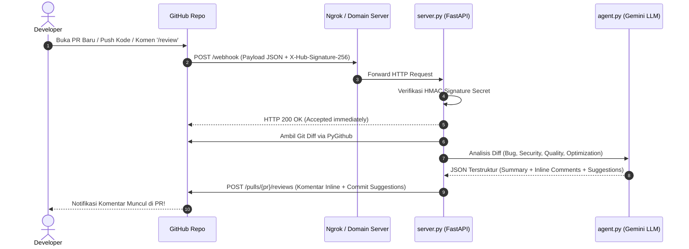

# Panduan Implementasi Pure Webhook AI Code Reviewer

Panduan ini berisi langkah-langkah **menghubungkan GitHub Webhook secara langsung ke AI Agent** tanpa menggunakan GitHub Actions.

Kode implementasi lengkap sudah tersedia di direktori ini:
- [`server.py`](file:///home/gli-budi-agf/StudioProjects/Agent%20Review/server.py): Server FastAPI penerima webhook GitHub & pengirim review inline ke PR.
- [`agent.py`](file:///home/gli-budi-agf/StudioProjects/Agent%20Review/agent.py): Otak AI (analisis bug, security, code smells, dan pembuatan saran perbaikan).
- [`.env.example`](file:///home/gli-budi-agf/StudioProjects/Agent%20Review/.env.example): Template konfigurasi token & secret.
- [`Dockerfile`](file:///home/gli-budi-agf/StudioProjects/Agent%20Review/Dockerfile): File container untuk deployment ke VPS atau cloud.

---

## 1. Arsitektur Alur Kerja (Pure Webhook)



---

## 2. Persiapan Kredensial

Sebelum menjalankan server, siapkan 3 kunci berikut:

1. **GitHub Personal Access Token (PAT)**:
   - Buka GitHub -> Klik avatar profil (kanan atas) -> **Settings** -> **Developer settings** -> **Personal access tokens** -> **Tokens (classic)**.
   - Klik **Generate new token (classic)**.
   - Beri nama (misal: `AI Reviewer Bot`).
   - Centang hak akses:
     - `repo` (Full control of private repositories) — jika repo private.
     - Atau minimal `public_repo` (jika repo publik).
   - Salin token tersebut (berawalan `ghp_...`).

2. **Google Gemini API Key**:
   - Dapatkan dari [Google AI Studio](https://aistudio.google.com/).

3. **Webhook Secret**:
   - Buat kata kunci rahasia acak Anda sendiri, misalnya: `kunci_rahasia_reviewer_123`.

---

## 3. Menjalankan Server Webhook

### Langkah 1: Pasang Dependencies

```bash
cd "/home/gli-budi-agf/StudioProjects/Agent Review"
python3 -m venv venv
source venv/bin/activate
pip install -r requirements.txt
```

### Langkah 2: Buat File `.env`

Salin dari contoh:
```bash
cp .env.example .env
```
Lalu edit file `.env`:
```env
GITHUB_TOKEN=ghp_xxxxxxxxxxxxxxxxxxxxxxxxxxxx
GITHUB_WEBHOOK_SECRET=kunci_rahasia_reviewer_123
GEMINI_API_KEY=AIzaSyxxxxxxxxxxxxxxxxxxxxxxx
AI_MODEL=gemini-2.5-pro
PORT=8000
```

### Langkah 3: Jalankan Server Lokal

```bash
python server.py
```
Server akan aktif di `http://0.0.0.0:8000`.

---

## 4. Menghubungkan Server ke GitHub

Agar GitHub (di cloud) bisa mengirim request ke server lokal di laptop/komputer Anda saat pengujian, gunakan tool tunneling seperti **ngrok** atau **Cloudflare Tunnel**.

### Opsi A: Pengujian Lokal dengan Ngrok
Jalankan di terminal baru:
```bash
ngrok http 8000
```
Anda akan mendapatkan URL publik HTTPS, misalnya:
`https://abc1-23-45-67.ngrok-free.app`

### Opsi B: Di Server / VPS Produksi
Jika dideploy di VPS / Cloud Run / Railway, gunakan domain server Anda, misalnya:
`https://ai-review.perusahaan.com`

---

## 5. Mendaftarkan Webhook di Repositori GitHub

1. Buka repositori GitHub yang ingin direview otomatis.
2. Masuk ke tab **Settings** -> pilih menu **Webhooks** di bilah kiri.
3. Klik tombol **Add webhook** (masukkan password GitHub jika diminta).
4. Isi form sebagai berikut:
   - **Payload URL**: Masukkan URL server Anda ditambah path `/webhook`.  
     *Contoh*: `https://abc1-23-45-67.ngrok-free.app/webhook`
   - **Content type**: Pilih **`application/json`** *(Sangat penting, jangan pilih `x-www-form-urlencoded`)*.
   - **Secret**: Masukkan secret yang sama dengan `GITHUB_WEBHOOK_SECRET` di file `.env` Anda (`kunci_rahasia_reviewer_123`).
   - **SSL verification**: Pilih **Enable SSL verification**.
   - **Which events would you like to trigger this webhook?**:
     - Pilih **Let me select individual events**.
     - Centang:
       - ☑️ **Pull requests** (mentrigger saat PR dibuka, diupdate, atau re-opened).
       - ☑️ **Issue comments** (mentrigger saat ada yang mengetik komentar `/review` di PR).
   - Centang **Active**.
5. Klik **Add webhook**.
6. GitHub akan mengirimkan request `ping`. Jika ikonnya berubah menjadi centang hijau `✓`, berarti webhook sukses terhubung!

---

## 6. Uji Coba Langsung di GitHub

Sekarang sistem Anda sudah siap:
1. Buat branch baru di repositori Anda, ubah beberapa baris kode (misal buat sengaja ada bug atau kode tanpa exception handling), lalu buat **Pull Request**.
2. Periksa terminal `server.py` Anda:
   - Server akan menerima event `pull_request` (Action: `opened`).
   - Server langsung membalas `200 OK` ke GitHub.
   - Background worker mengambil diff kode, mengirimkannya ke Gemini, dan menyusun laporan review.
3. Buka halaman Pull Request di GitHub:
   - Dalam hitungan beberapa detik, **bot akan langsung memposting review lengkap**.
   - Komentar saran akan menempel langsung pada baris kode yang bermasalah lengkap dengan tombol **Commit suggestion**!
4. Anda juga bisa mengetik komentar `/review` di PR kapan saja untuk meminta AI mereview ulang.

